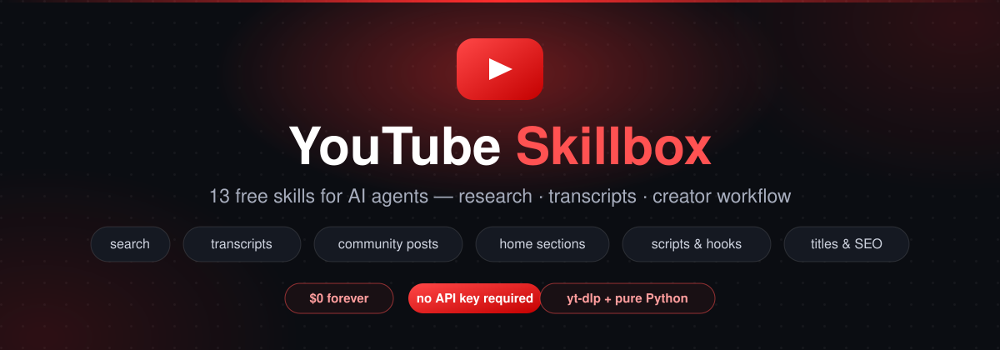

<div align="center">
  
  <h1>YouTube Skillbox — Anna App</h1>
  <p><strong>Evidence-backed YouTube audits, keyword research and content fixes — inside Anna AI OS.</strong></p>
  <p>
    
    
    
    
  </p>
</div>

## What this is

The **Anna App edition** of [YouTube Skillbox](https://github.com/hackers-reality/youtube-skillbox) — the open-source (MIT) YouTube research kit. Everything is free, runs on public YouTube data, and needs **no user-supplied API keys**.

If the original repo is for **AI agents** (OpenCode, Claude Code, …), this repo is for **Anna users**: a polished, interactive app with a UI that does the same work through one click — the App, not a CLI, is the product.

| Tab | What you get |
|---|---|
| 🎯 **Audit My Channel** | Channel URL → snapshot (subs, videos, shorts, cadence), outliers (views/subs), keyword angles (opportunity vs competition) → host-LLM synthesis with **MEASURED / INFERRED / HYPOTHESIS** labels, plus the *one* thing to fix. Saves audits to your Anna storage. |
| ✍️ **Content Studio** | The Skillbox creator workflow, guided for humans: 21 hook options scored honestly, 5 lint-checked titles (truncation-safe), description + tags, chapters, Shorts extraction, thumbnail text. |
| 📉 **Retention Fix** | Paste a Studio audience-retention CSV (or describe the graph) → hook leak, cliffs, slide — with the exact fix. |

## Architecture

```
uiref
bundle/ (static SPA)          ← this repo, user-facing
        │ anna.tools.invoke
        ▼
executas/youtube-skillbox/     ← this repo, thin JSON-RPC wrapper
        │ python -m youtube_skillbox.cli
        ▼
PyPI youtube-skillbox ≥0.4.13  ← the engine (2500-line ytdata.py + skills)
        │ yt-dlp + Innertube + Google suggest + DDG
        ▼
YouTube (public data)
```

The App **does not copy the engine** — it depends on the published PyPI package, so every engine fix flows in automatically (`hybrid` loop: build once, use everywhere).

## Development

```bash
npm i -g @anna-ai/cli        # once
anna-app login               # once (developer console → activate first)

anna-app dev                 # local harness → http://localhost:5180
anna-app validate --strict    # schema + ACL checks
anna-app apps push          # push working draft to developer console
anna-app apps cut 0.1.0      # freeze & version
```

Local state is gitignored (`.anna/`, `node_modules/`, `dist/`).

## Repository layout

```
bundle/                 Static SPA UI (vanilla JS, no build step)
executas/youtube-skillbox/  Python stdio Executa → PyPI engine
app.json                Store listing metadata
manifest.json           Anna App manifest (schema 4)
assets/                 Banner + listing art
THIRD_PARTY_LICENSES/   Attribution for the upstream creator-skill engine
```

## What *not* to commit

`.anna/` (CLI tokens), `fixtures/`, `tmp/`, `node_modules/`, `dist/`, `reports/`, any `.jsonl` with audit output, `dev.key` — see `.gitignore`. Audit files may contain personal channel data; keep them local.

## Attribution

- **YouTube Skillbox** — the engine, MIT © 2026 hackers-reality. https://github.com/hackers-reality/youtube-skillbox
- **yt-agent-skill** — the upstream creator-skill prompts this App adapts from (MIT © Jake Schincariol), preserved in `THIRD_PARTY_LICENSES/youtube-agent-skill_LICENSE.txt`.
- The audit report's LLM synthesis and retention analysis run through Anna's hosted LLM — no model keys in this repo, ever.

## License

MIT — see [LICENSE](LICENSE). Use it, fork it, ship your own version. Attribution appreciated.
